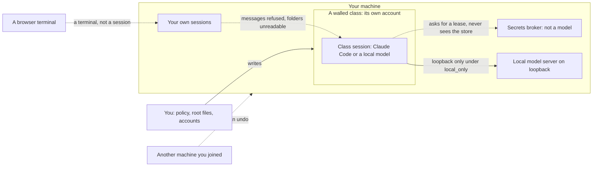

# The wall

The wall is the rule that a session can write only inside its project folder (and a few folders ws names), and can read
nothing under your `deny_read` paths, whatever program it starts.

## The rule

A walled session sees the whole disk read-only, except the project folder, a private temporary folder, the runner's own
private state and any folder you list in `allow_write`. ws's own files are read-only even when one sits inside the
project. Paths you deny for reading look empty.

## Why it exists

The [gate](gate.md) reads the text of a command. A program that builds a path at run time, an interpreter, a script that's
written and then run, or the version-control tool restoring a file all do their work below the text. A sandbox acts on the
system calls themselves, so a write to a protected file fails with a read-only error whatever program makes it.

The second reason is delayed harm. A session that can write a git hook, a runner plugin or a shell start-up file leaves
something that runs later, outside any wall. The wall treats those files as read-only for the same reason.

## How ws enforces it

The code is `src/ws/sandbox.py`. You reach it with `ws gate launch --runner R -- COMMAND`.

| Where | What ws uses |
|---|---|
| Linux, WSL2 | bubblewrap, with a seccomp filter that ws compiles itself |
| macOS | `sandbox-exec` with a generated profile (untested on a real Mac; see below) |
| Claude Code | Claude Code's own sandbox, switched on by the settings ws generates |

What a walled session can't do:

- **Write outside its allow-list.** Root is read-only. The project folder, a private temporary folder, the runner's
  private folders and `allow_write` are writable.
- **Plant something that runs later.** The folders and files a runner or git loads at start are read-only whether or
  not they exist: `.claude`, `.opencode`, `.mcp.json`, `opencode.json`, `tui.json`, and in every git folder the hooks,
  config and submodule repositories. `mv .git .git2` is refused. OpenCode's data and cache folders are private to the
  wall and to the project, so a program planted there can't run outside the wall.
- **Reach the host.** Unix sockets are shut (no `tmux`, `screen`, `docker` or `systemd-run --user` on the host), the host
  process list is hidden, and typing into your terminal (`TIOCSTI`) is refused. `ptrace` and `process_vm_*` are refused.
- **Read denied paths.** A `deny_read` folder becomes an empty folder and a denied file becomes `/dev/null`.

After every walled run, the launcher compares the project with how it was and reports anything that will run later: a
new or changed git folder, runner config, program loaded on its own in a virtual environment or `node_modules`. It reports
and deletes nothing. The report goes to standard error and to `~/.local/state/ws/logs/wall-report.jsonl`.

In a Claude Code session started with `ws gate launch --runner claude-code -- claude`, the settings also hide your home
folder from every shell command, except the project and the folders common tools need (`allow_read` adds more); see
[Use the wall](../how-to/use-the-wall.md#deny-the-home-folder).

In Claude Code the wall is on by default. `ws install` merges Claude Code's own `sandbox` settings into your
`settings.json` (the same block `ws gate launch` uses), and that block is the wall for shell commands: the `deny_read`
paths read as empty and ws's files refuse a write, for every program a command starts. The gate reads the same text
whether or not the wall is up, and nothing it refuses is allowed because a wall exists: allow-with-log isn't in 0.1.8.
[`sandbox = false`](../reference/policy.md#gate) under `[gate]` leaves the block out, and the session is then unsandboxed.

Claude Code merges its settings from every file it reads, so another setting can open the block again: `sandbox.enabled`
set to false, an `excludedCommands` entry, `allowUnsandboxedCommands`, or an `allowRead` or `allowWrite` entry over a
path the wall holds. `ws install` refuses, naming each setting and its file, unless you keep them on purpose with
`ws install --allow-widened-sandbox`. ws then records the choice, and `ws doctor` (WS012) reports "wall widened by user"
for as long as one is there. Settings that ws can't see (a `--settings` flag, a managed policy outside the files
`ws doctor` reads) can widen the wall too. Doctor reports what it can read.

## A walled class as an operating-system boundary

A data class with an `os_user` is a walled class, and it's optional: it needs a second account on a Linux or macOS
machine. Its boundary is built from controls the runner and the OS already have: the class's own account, folder modes
(your home closed to other accounts), Claude Code's settings keys and its sandbox. ws writes and checks those keys; it
enforces nothing new.

Each walled class has two root-owned settings files. The managed-settings file is the machine-wide drop-in in Claude
Code's managed-settings folder, which Claude Code reads for every account on the machine, so a bare `claude` run as the
class account is bound by it. It holds the sandbox required and no unsandboxed retry; bypass off; writes only in the
class's repos and scratch; the home folder unreadable except those repos; inbound lead-only; and the network shut but for
the class's own hosts (`allowedDomains` with `allowManagedDomainsOnly`). The launch file is one per class, in a
`ws-classes` folder beside the managed-settings folder, which Claude Code doesn't read. `ws gate launch` reads the class's
launch file and merges it into the settings copy it passes to Claude Code with `--settings`, its keys winning, so a
session of another class, or of none, is never given it. It holds `Read` and `Edit` denied for the home folder, ws's own
folders and the other classes' repos; file reads held to the working folders; messages from other sessions refused
(`crossSessionInbound`, with `SendMessage` and `ListAgents` denied, and `isolatePeerMachines`, which only asks before a
cross-machine send); `disableAllHooks` false; the other classes' repos unreadable; the network held to the class's hosts
(`strictAllowlist`); the class marker; and OpenTelemetry prompt and tool-content logging off. A launch with no launch file
is refused (exit 3). A key Claude Code reads only from managed settings isn't written to the launch file: see
[ADR 0027](../decisions/0027-a-settings-file-per-walled-class.md). One class per machine is the tested shape: see
[Known limits](known-limits.md).

A walled session's project is read against an allow-list, because Claude Code reads a repository's `.mcp.json` and
`.claude/settings*.json` itself. A `.mcp.json` may start no MCP server. A settings file may hold only `model`,
`permissions` (`deny`, `ask` and a `defaultMode` of `plan` or `default`), `attribution`, `includeCoAuthoredBy`,
`outputStyle`, `language`, `cleanupPeriodDays`, `respectGitignore`, a `sandbox` table that only narrows (it may add
denials, and keep the sandbox on; any key that could open it gets refused whatever its value, `enableWeakerNestedSandbox`
and `enableWeakerNetworkIsolation` included), an `env` of nine named variables, and the schema key; any other key is
refused, naming it. The check also reads the frontmatter of the project's skills, agents and commands, and refuses a
`hooks` key, an agent's `mcpServers` or `permissionMode`, and a skill's or command's `allowed-tools`; any
`.claude/workflows/*.js` is refused. It reads the folder, each folder above it and, for a git worktree, the main
checkout. A file that exists but doesn't read (empty, not JSON, a header with no closing fence) is refused, not skipped.
ws refuses before the runner starts (a SessionStart hook can't block) and again on every call. The gate hook is
registered for every tool and runs under every permission mode, bypass and auto included.

`ws walls check` checks without sudo, case by case, that these settings are in place: it reads the files, the account
and the modes, and asks the gate's own functions about a probe call. It's not a live test that the runner enforces them.
It exits 1 when a case fails or the host isn't set up.
`ws walls canary` runs the same cases on a world it plants, with files as ws renders them, so it needs no class set up:
it shows that what ws writes holds, and `ws walls check` shows that your host holds it.

Each class's launch file carries its own write block (`permissions.blockWritesOutsideWorkingDirectories`) and its own
token deny (`sandbox.credentials.envVars`), so a class session has both whatever the generated settings say, and it
switches off Remote Control and the claude.ai connectors. None of these is in the managed-settings file, which Claude
Code applies to every account on the machine: they'd bind your own sessions too.
Set-up is [yours to run](../how-to/set-up-a-class-user.md): ws prints the commands and the way out, and runs none of them.

The wall fails closed. With no bubblewrap, or with unprivileged user namespaces switched off, `ws gate launch` refuses and
prints the install line. `--no-sandbox` starts the runner bare and says what that gives up, so skipping the wall is a
visible choice.

## The boundaries, and who holds each side

ws draws five boundaries. Each one has a side you control and a side a session, a model or another machine controls.

For each, Shostack's four questions: what are we working on, what can go wrong, what are we doing about it, and did we
do a good job.

| Boundary | Who controls each side | What can go wrong | What ws does | How you know it holds |
|---|---|---|---|---|
| A walled class | You hold the policy, the root-owned class files and the account; the session holds only its repos | A session reads another class's folder, sends a message out, or reaches a host the class doesn't list | Its own account, a managed file and a launch file, messaging tools denied, a host allowlist | `ws walls canary` on any machine; `ws walls check` on yours |
| A local model in a class | You choose `local_only`; the model gets what the class gives a Claude session | A local session gets less of the wall than a Claude one, or a hosted model is used instead | The same launch file, loopback only, a hosted provider refused before it starts | The `local-model-in-wall` case |
| The secrets broker | You paste values; the broker holds the store; a session holds a lease at most | A session reads a value or keeps one past the run | The broker is the only process that holds values; a job gets a lease | `ws doctor`, and the broker's own log |
| Another machine | You join it; the other machine keeps its own account | A join leaves something behind that can't be taken out | Every change a join makes is written in a ledger as it's made | `ws node show` lists it, and `ws node remove` takes it out |
| A browser terminal | You hold the sign-in; the browser holds a terminal | A page in the browser drives a session | `ws term` refuses to listen on every interface | Its tests, and the typed refusal of `--bind 0.0.0.0` |

## What the wall doesn't stop

- **The network.** The wall leaves the network as it's, because the runner needs its model. `allow_hosts` filters hosts
  on Claude Code only.
- **`/proc/PID/mem` at `ptrace_scope` 0.** On a host where `kernel.yama.ptrace_scope` is 0, a process in the wall can read
  the memory of a runner that doesn't mark itself non-dumpable (Claude Code). `ws doctor` warns (WS007) and prints the
  `sysctl` line that fixes it.
- **The macOS wall is unproven.** The `sandbox-exec` profile is tested as text only. No CI job runs it on a Mac.
- **Things created during the session.** A repository the session makes with `git init`, a submodule it adds and config
  in a sub-folder (`sub/.claude`) are reported after the run, not blocked.
- **A shell command inside an interpreter.** A `deny_commands` rule doesn't apply inside `python3 -c`. Only the file
  rules of the wall do.
- **OpenCode's `patch` tool.** It's not a shell command, so the wall doesn't cover it.
- **A program that writes a hard-coded path outside the allow-list.** It fails. Add the folder to `allow_write`.

See [Known limits](known-limits.md) for the full list.

## Do it

Follow [Use the wall](../how-to/use-the-wall.md).
